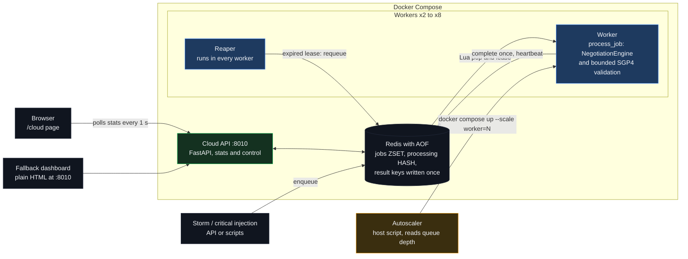
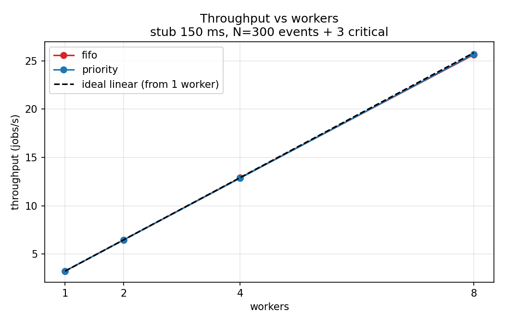
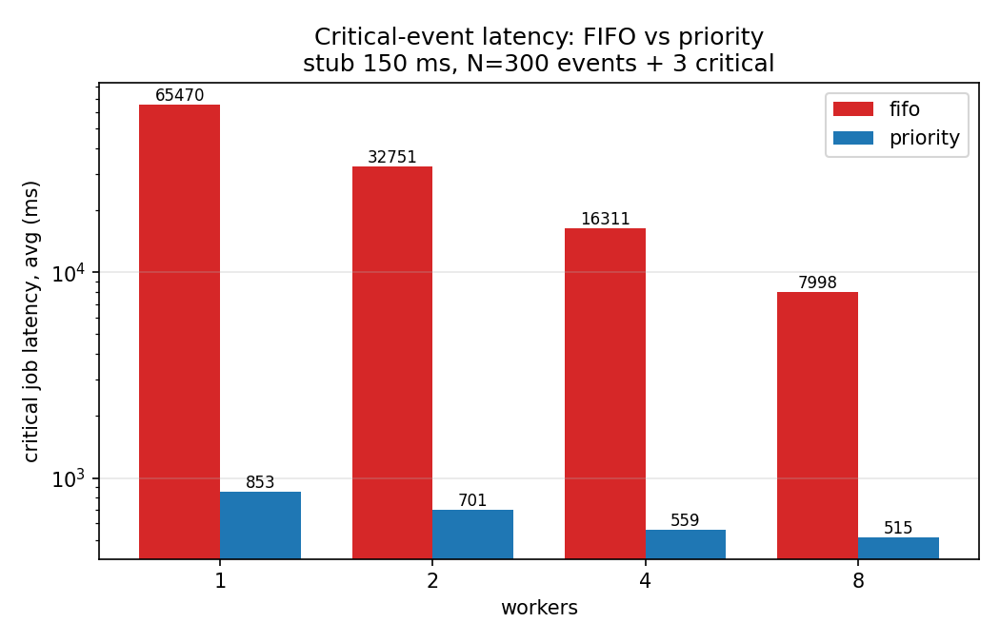
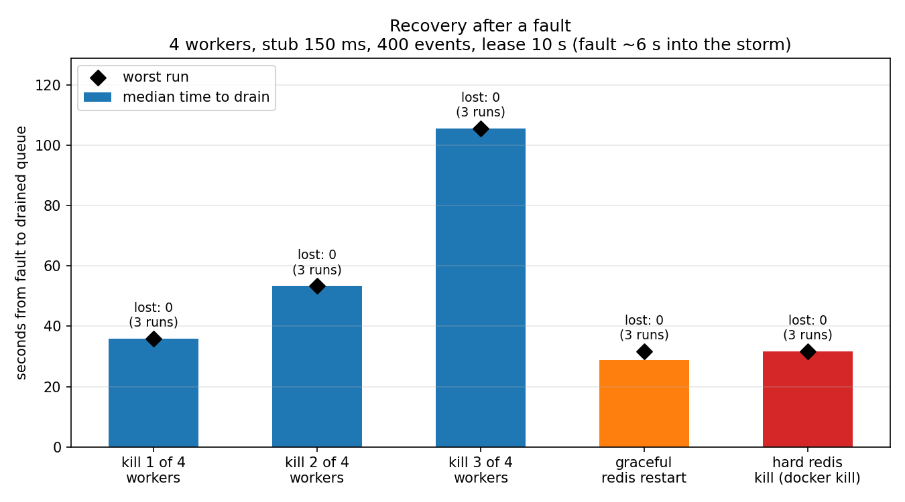
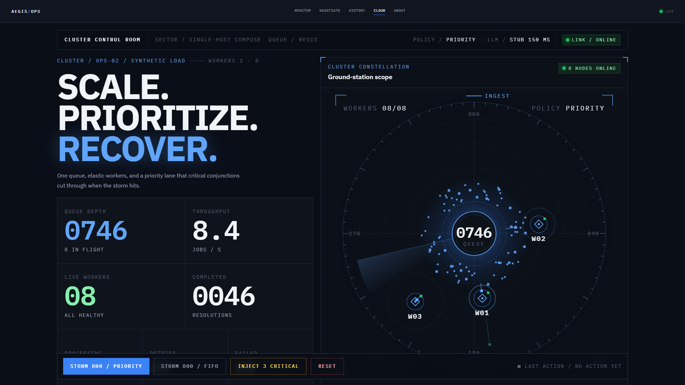
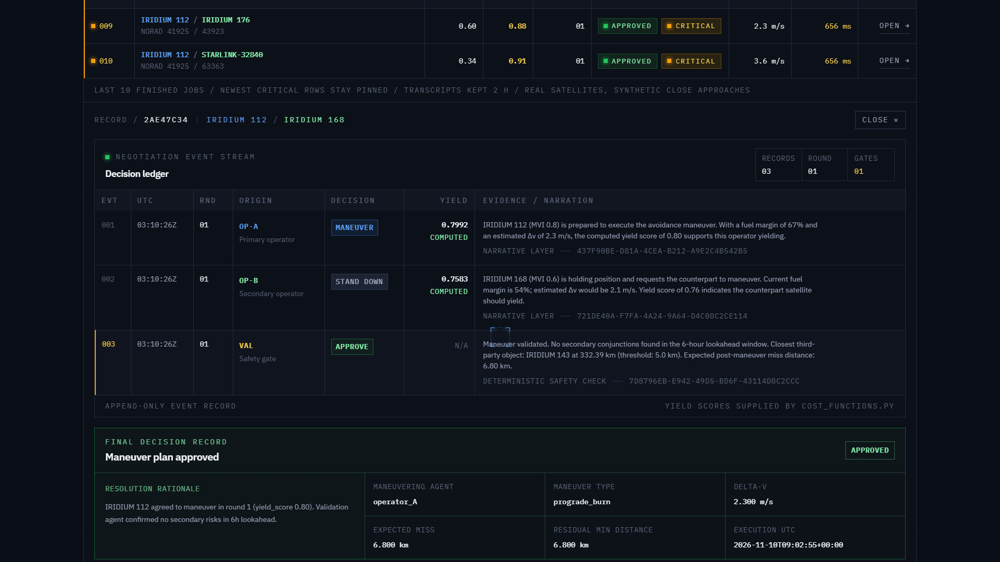
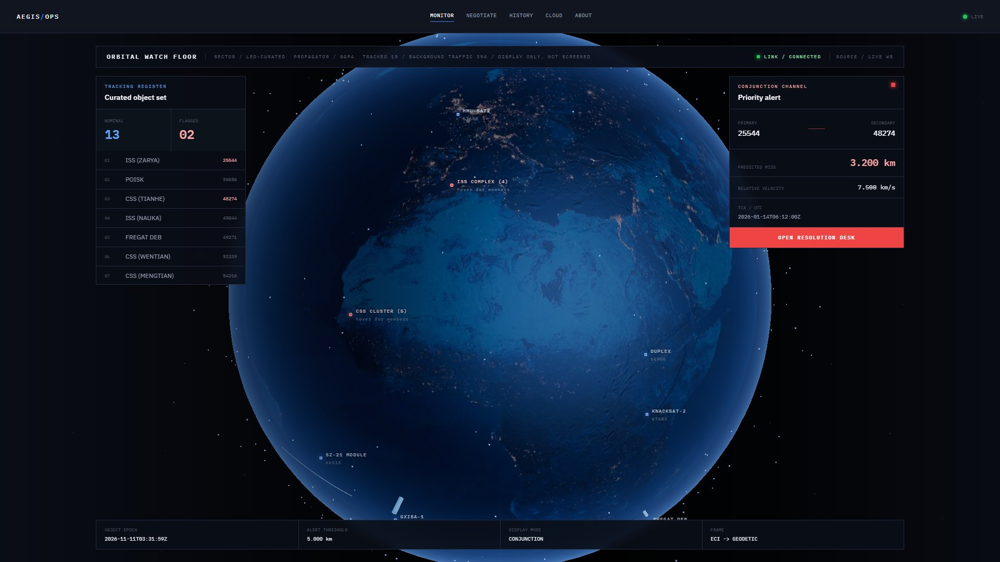
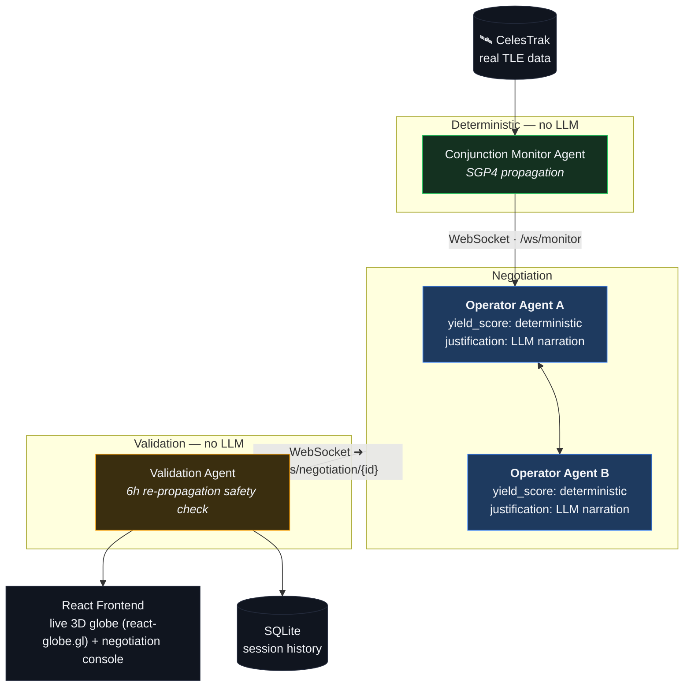

<div align="center">

# 🛰️ Aegis

**Autonomous multi-agent orbital collision de-confliction.**

[](#team)
[]()

<p>


<br>


<br>


<br>


</p>

Aegis replaces the manual, email-based satellite collision-avoidance process with autonomous negotiation agents — one per satellite operator — that detect a real conjunction event, negotiate who maneuvers using real orbital physics and mission-priority data, and produce a fully auditable resolution.

*No standardized automated protocol exists for this today. Aegis is a working demonstration of what one could look like.*

*Aegis now also runs as a distributed system: the same negotiation engine, behind a Redis priority queue and autoscaled workers, handles hundreds of (synthetic) conjunction events at once.*

</div>


---

## The Problem

When two satellites from different operators are on a collision course, resolution today happens through **manual emails between engineers** — a real, documented bottleneck (e.g. the 2019 SpaceX/ESA Starlink–Aeolus incident). As LEO gets more crowded, this doesn't scale.

## What Aegis Does

| Step | Description |
|---|---|
| **1. Detect** | Finds a real close-approach conjunction from live/cached CelesTrak TLE data, propagated with SGP4. |
| **2. Negotiate** | Two autonomous operator agents reason over mission priority and fuel cost, exchange proposals over multiple rounds, and converge on who maneuvers. The `yield_score` that actually decides the outcome always comes from deterministic Python — the LLM only narrates it in plain language. |
| **3. Validate** | A third agent re-propagates the proposed maneuver 6 hours forward to confirm it doesn't create a *new* collision risk before approving it. It can also honestly report "no safe maneuver found." |
| **4. Visualize** | A live 3D globe shows the conjunction, the negotiation as it happens, and the resulting trajectory change. |

---

## Cloud Redesign: from one conjunction to a storm

The original Aegis resolves one event in one process. The redesign wraps the **same `NegotiationEngine`** in a Redis priority queue, stateless worker containers, lease-based crash recovery, a queue-depth autoscaler, AOF persistence with Redis-outage tolerance, a stats API, and a new `/cloud` page inside the existing React app. Critical conjunctions (ranked by a heuristic risk score, not a collision probability) jump the queue; the cluster scales itself from 2 to 8 workers; and killing workers or Redis mid-storm did not lose a job in our chaos runs. The scripted ISS–CSS scenario on the Monitor is untouched.



### Headline results

Setup: **stub 150 ms LLM latency** (about 0.3 s per job), **single-host Docker Compose**, measured on **one laptop** — scaling behaviour, not production capacity. Every number below is read from a file in [`results/`](results/).

| What was measured | Result | Source |
|---|---|---|
| Critical-job latency, 1 worker, FIFO vs priority | **65.5 s → 0.85 s** (about 77×) | `results/benchmark.csv` |
| Critical-job latency, 8 workers, FIFO vs priority | **8.0 s → 0.52 s** (about 15.5×) | `results/benchmark.csv` |
| Throughput, 1 / 2 / 4 / 8 workers (priority) | **3.24 / 6.45 / 12.87 / 25.70 jobs/s** — about linear (7.9× at 8 workers); FIFO is the same, so priority costs no throughput | `results/benchmark.csv` |
| Throughput with the 400-satellite pool (bounded validation) | 3.07 jobs/s at 1 worker, 12.33 at 4 (4.0×), 200 events | `results/benchmark_pool_quick.csv` |
| Autoscaling an ≈800-event storm | 2 → 8 workers on the first poll that saw the storm; queue empty about 33 s later (≈124 s at 2 workers: 800 / 6.45 jobs/s, arithmetic) | `results/autoscaler_run.log`, `results/benchmark.csv` |
| Chaos: kill 1 / 2 / 3 of 4 workers | 0 jobs lost; retries 1 / 2 / 3; drained in 35.8 / 53.3 / 105.5 s (median of 3) | `results/chaos.csv` |
| Chaos: Redis restart / hard kill | 0 jobs lost; reconnect 1.1 s / 6.1 s; drained in 28.7 / 31.7 s | `results/chaos.csv` |
| Chaos, all runs | **0 jobs lost, 0 failed in all 20 runs** (15 full at 400 events, 5 quick at 200) | `results/chaos.csv` |

`benchmark.csv` is 300 normal + 3 critical events (seed 42) and predates the 400-satellite pool. Full tables and caveats: [`CLOUD.md`](CLOUD.md), [`docs/CLOUD_PROGRESS_REPORT.md`](docs/CLOUD_PROGRESS_REPORT.md).

| Throughput vs workers | Critical latency, FIFO vs priority |
|:---:|:---:|
|  |  |

<div align="center">
  <b>Recovery after a fault</b> (4 workers, 400 events, lease 10 s)<br/><br/>
  
</div>

---

## Previews

| Live Orbital View | Negotiation Console & Result |
|:---:|:---:|
|  |  |

<br />

<div align="center">
  <b>Resolution Archive</b><br/><br/>
  
</div>

<br />

| `/cloud` mid-storm | `/cloud` Resolution Records |
|:---:|:---:|
|  |  |

<div align="center">
  <b>Monitor with display-only background traffic</b> (394 real LEO satellites behind the 15 curated objects)<br/><br/>
  
</div>

---

## Architecture

### Single-conjunction pipeline



### Cluster architecture

The cluster diagram is [above](#cloud-redesign-from-one-conjunction-to-a-storm). One job = one conjunction negotiation: `process_job(job)` runs the negotiate-and-validate steps of the pipeline as a pure function, and workers call it. The contract in short (full version in [`CLOUD.md`](CLOUD.md)):

- **Redis keys:** `jobs` (ZSET, lowest score pops first), `job:<id>`, `processing` (HASH id → lease deadline), `result:<id>`, `retries:<id>`, `workers` (heartbeats), `recent*` / `transcript:<id>` (resolution records, 2 h TTL).
- **Lease + reaper:** a Lua script pops a job and leases it atomically; every worker runs a reaper (every 5 s) that requeues expired leases with their original score, up to `MAX_RETRIES` (3), then writes a `failed` result. Delivery is at-least-once.
- **Idempotent completion:** `result:<id>` is written with `SET ... NX`, so a duplicate run changes nothing: the first result wins.
- **Priority with aging:** `score = enqueued_at * 0.002 - risk` (FIFO uses `enqueued_at`). Risk = `0.5·closeness + 0.3·urgency + 0.2·mission`; critical at ≥ 0.8. A critical job loses to a normal one only after about 400 s of extra waiting.
- **Autoscaler:** host script, scales on queue depth between 2 and 8 workers (target 25 queued per worker, 2 s poll): up immediately, down one step per 10 s cooldown, never below the in-flight jobs.
- **Resilience:** AOF persistence on a named volume; workers and the API retry Redis with capped exponential backoff; the API answers `503 {"error":"redis_unavailable"}` during an outage.

Tech stack:

- **Backend:** FastAPI, WebSockets, `sgp4`, Pydantic, Anthropic API
- **Cluster:** Redis (queue, leases, persistence via AOF), Docker + Docker Compose (workers, scaling), Lua (atomic queue scripts)
- **Frontend:** React + Vite, `react-globe.gl`, `satellite.js`, Three.js (Monitor background-traffic layer; installed via `react-globe.gl`), Tailwind CSS, Zustand
- **Data:** CelesTrak (TLE, no auth), NOAA SWPC (space weather — stretch goal, not implemented)

 Full technical detail in [`context/architecture.md`](context/architecture.md).

---

## What's Real vs. Simulated

We're upfront about this, since it matters for evaluating the demo honestly:

| Component | Status |
|---|:---:|
| Satellite tracking data | 🟢 **Real** — CelesTrak TLEs, real SGP4 propagation (independently verified against a known reference position). 15 curated objects on the Monitor, plus a pool of 400 real LEO satellites (fetched once, cached); 394 are drawn as **display-only** background traffic on the Monitor globe and are **not screened** for conjunctions |
| Conjunction detection | 🟢 **Real** — actual computed miss-distance/TCA on a 🟡 **scripted** scenario: the Monitor's ISS–CSS alert has a fixed TCA, it is not a live prediction |
| Conjunction events in cloud storms | 🟡 **Synthetic** — random pairs of real satellites with injected miss distances (0.3–5 km); not real conjunctions |
| Negotiation math (`yield_score`, Δv) | 🟢 **Real** — deterministic, auditable, traced to source in every UI display |
| Trajectory simulation | 🟢 **Real** — Keplerian two-body + J2 oblateness, RK4 integration |
| Queue, leases, reaper, scheduler, autoscaler, persistence | 🟢 **Real machinery** — failure recovery exercised by the chaos runs |
| Mission priority / fuel data | 🟡 **Simulated** — no public API exposes real per-satellite operational data (derived deterministically per constellation for pool satellites) |
| LLM negotiation narration | 🟢 **Real LLM calls** in the original app, with a deterministic template fallback if unavailable. 🟡 **Simulated** in cloud storms (template + 150 ms stub latency); `LLM_MODE=real` exists but is not used in the benchmarks |
| Risk score | 🟡 **Heuristic** — not a collision probability (TLEs carry no covariance) |
| Scale | 🟡 **Single-host Docker Compose** — stands in for Kubernetes/KEDA; not production capacity |
| Session history persistence | ✅ **Real & Live-wired** — Complete negotiations and trajectory results are securely saved to local SQLite via `storage/db.py` and instantly queried by the History tab |

---

## Getting Started

### Original app (single conjunction)

```bash
# Backend
cd backend
pip install -r requirements.txt
uvicorn app.main:app --reload

# Frontend
cd frontend
npm install
npm run dev
```

Open **http://localhost:5173**. The backend runs entirely on cached/seeded data by default — no external API calls are required to see the full demo.

### Cloud cluster

Needs Docker Desktop. Three terminals, as in [`DEMO.md`](DEMO.md) (PowerShell, from the repo root):

```powershell
# window 1 - cloud stack
Set-Content .env "LEASE_SECONDS=10"        # short lease so the crash demo is fast
docker compose up -d redis api
docker compose up -d --scale worker=2 worker

# window 2 - original backend (OFFLINE=1: TLEs from the committed snapshot, never the network)
cd backend
$env:OFFLINE = "1"
python -m uvicorn app.main:app --port 8000

# window 3 - React app
cd frontend
npm run dev
```

<details>
<summary>bash equivalents</summary>

```bash
# window 1
echo "LEASE_SECONDS=10" > .env
docker compose up -d redis api
docker compose up -d --scale worker=2 worker

# window 2
cd backend && OFFLINE=1 python -m uvicorn app.main:app --port 8000

# window 3
cd frontend && npm run dev
```

</details>

Open **http://localhost:5173/cloud**. Ports: Vite `5173`, original backend `8000`, cloud API `8010`, Redis `6379`. The plain fallback dashboard at **http://localhost:8010** works without windows 2–3. Preview the page without the stack at `/cloud?mock=storm` (also `idle`, `scaled`, `critical`, `dead`, `down`); turn the Monitor's background traffic off with `/monitor?traffic=off`.

**Reset before every run** — Redis persists its data, so leftovers resume processing. `docker compose down` keeps the data, `docker compose down -v` wipes it.

```powershell
Invoke-RestMethod -Method Post http://localhost:8010/api/cloud/reset     # bash: curl -X POST http://localhost:8010/api/cloud/reset
```

Code and scripts are baked into the image: run `docker compose build` after editing them. The full tested 5-step demo (reset, storm, autoscaler 2 → 8, critical injection, kill a worker) is in [`DEMO.md`](DEMO.md).

### Run the regression gate

```bash
python scripts/regression.py
docker compose run --rm worker python scripts/verify_queue.py
```

Both flush Redis. `regression.py` runs a 300-event priority storm with 3 critical jobs and checks 303 completed, 0 failed, a drained queue and the priority latency advantage.

---

## Project Structure

```text
backend/
  app/                      original app: agents, orchestrator, schemas, SQLite storage
    profiles.py             operator profiles + tracked-object loading (cloud path)
    data/cache/             tle_snapshot.json (15 curated), tle_pool.json (400 real LEO)
  cloud/                    queue.py (Redis + Lua), worker.py, jobs.py (process_job), events.py,
                            risk.py, scoring.py, resilience.py, api.py, static/ (fallback dashboard)
frontend/
  public/traffic-pool.json  394 satellites for the Monitor background traffic
  src/pages/Cloud.tsx       the /cloud page
  src/components/cloud/     cluster scope, panels, Resolution Records
  src/components/globe/BackgroundTraffic.ts   display-only traffic layer
  src/lib/                  cloudApi, cloudMock, useCloudStats, useCloudRecords, useTrafficSelection
scripts/                    enqueue, storm, autoscaler, benchmark, chaos, regression, verify_queue,
                            fetch_tle_pool, export_traffic_pool, plot_results, plot_chaos, ...
results/                    benchmark.csv, chaos.csv, autoscaler_run.log, charts, cloud-ui/, monitor-traffic/
docs/                       CLOUD_PROGRESS_REPORT.md, screenshots/
CLOUD.md  DEMO.md           as-built cloud contract, tested demo script
AGENTS.md  context/         the technical documentation the project was built against
docker-compose.yml  Dockerfile
```

---

## Documentation

| Document | What it is |
|---|---|
| [`CLOUD.md`](CLOUD.md) | As-built cloud contract: Redis keys, queue rules, API, env vars, scripts, gotchas |
| [`DEMO.md`](DEMO.md) | The tested live-demo script with timings and an "if X fails, do Y" table |
| [`docs/CLOUD_PROGRESS_REPORT.md`](docs/CLOUD_PROGRESS_REPORT.md) | Full progress report of the redesign: what was built, results, known issues |
| [`AGENTS.md`](AGENTS.md), [`context/`](context/) | Architecture, design system, coding standards and the phased build plan |

## Known limitations

- **Synthetic load.** Storm conjunctions are random pairs with injected miss distances, and the LLM text is a template with a simulated 150 ms latency. Benchmarks measure the machinery, not collision screening.
- **Single host.** Docker Compose on one laptop stands in for Kubernetes/KEDA. The cloud API has **no authentication** (open reset endpoint, CORS limited to localhost).
- **At-least-once delivery.** A lease that expires on a live worker causes a duplicate run (the first result wins, the work is wasted).
- **Persistence window.** AOF `everysec` can lose about 1 s of writes on a full system crash; our process-kill tests (`docker kill`) cannot reproduce that, so it is documented, not measured.
- **TLEs age.** The pool was fetched on 2026-11-10; regenerate it with `scripts/fetch_tle_pool.py` and `scripts/export_traffic_pool.py`. The background traffic depends on `react-globe.gl` internals and fails silently by design.
- **`npm run build` fails** because of satellite.js top-level await (identical before the cloud work); `npm run dev` works.
- **Known label bug, original page.** The engine's `residual_risk` on approved resolutions is a distance in km; the original Negotiate page prints it as a percent (`/cloud` shows it correctly).

---

## Team

Built by:

| Name | Role | GitHub |
|---|---|---|
| Samarth Kulkarni | Orbital Physics & Conjunction Detection | [@SamarthKulkarni-2005](https://github.com/SamarthKulkarni-2005) |
| Samarth P Rao | Orchestrator, Schemas & Realtime Backbone | [@Atomiicradius](https://github.com/Atomiicradius) |
| Samarth Sainath Naik | Agent Intelligence — Cost, Narration & Validation | [@Sxmxrth05](https://github.com/Sxmxrth05) |
| Rahul P | Frontend Experience & WebSocket Client | [@rahul-ez](https://github.com/rahul-ez) |

Cloud redesign (queue, workers, autoscaler, /cloud page, benchmarks): Samarth P Rao ([@Atomiicradius](https://github.com/Atomiicradius)).

---

## Demo Video

[**Watch the high-quality Aegis Demo Video here!**](https://drive.google.com/drive/folders/1JcMrWcq07U5YDgG5eUyLvBj_2d6sj5Ue?usp=sharing)
